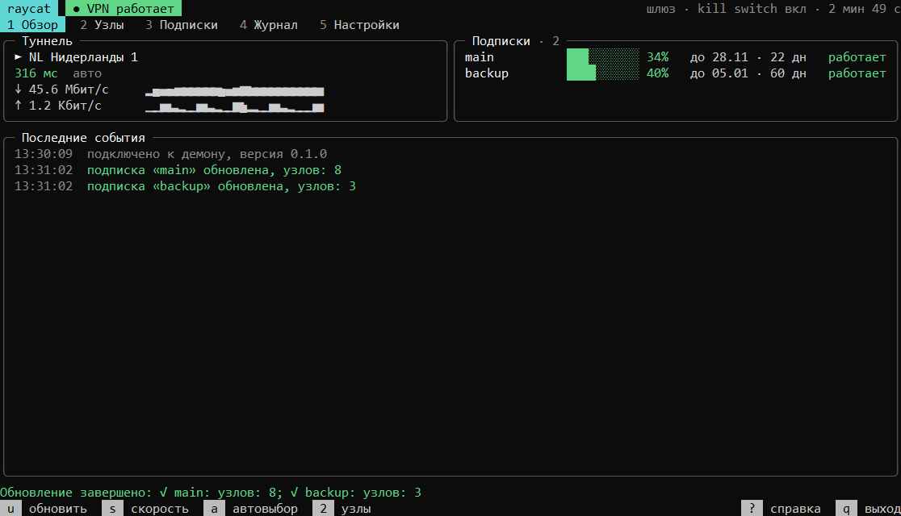

<picture>
  <source media="(prefers-color-scheme: light)" srcset="logo-light.svg">
  
</picture>

### Открытые инструменты, чтобы VPN работал на сервере сам

Подключаете подписку один раз, а дальше нужные контейнеры, весь сервер или домашняя сеть выходят в интернет через неё.

[**raycat**](https://github.com/raycat-app/raycat) · [Выпуски](https://github.com/raycat-app/raycat/releases) · [Обсуждения](https://github.com/raycat-app/raycat/discussions)

 

| Что идёт через VPN | Как это работает |
| --- | --- |
| **Отдельные контейнеры** | raycat в Docker, остальной сервер работает как обычно |
| **Весь сервер** | raycat службой, без туннеля трафик не выходит наружу |
| **Отдельные программы** | прокси HTTP и SOCKS5 на `127.0.0.1:7890` |
| **Домашняя сеть** | телевизор или приставка выходят через сервер |

<b>English</b>

 

raycat keeps a VPN subscription running on a Linux server. Chosen containers, the whole server or your home network go online through it, without configuring each application. See the [repository](https://github.com/raycat-app/raycat/blob/main/README.en.md).

